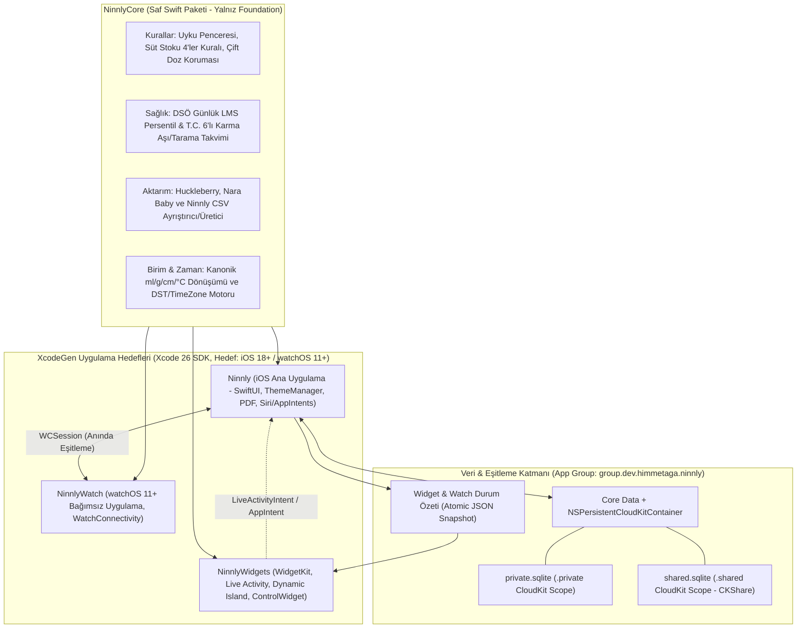

# Ninnly — Teknik Mimari Araştırma Raporu (M3)

**Tarih:** 16 Kasım 2026  
**Kapsam:** Apple platformları (iOS, watchOS, Xcode, CloudKit, ActivityKit, WidgetKit, App Intents, Swift Charts, XCTest / Swift Testing ve GitHub Actions CI/CD) için birincil resmi kaynaklara dayalı teknik mimari araştırması.  
**Bağlam Atfı:** T.C. aşı takvimi, yenidoğan taramaları, DSÖ büyüme standartları lisansı, CDC/AAP anne sütü saklama süreleri, uyanıklık pencereleri, Huckleberry/Nara Baby CSV şemaları ve App Store Review Guidelines (1.4.1, 5.1.3, 2.3.7, 1.3) konuları `docs/arastirma/A1_kaynak_dogrulama.md` ve `docs/PLAN.md` belgelerinde doğrulandığı için bu raporda yeniden araştırılmamış, yalnızca teknik entegrasyon noktalarında atıf yapılmıştır. Birincil resmi kaynaktan doğrudan teyit edilemeyen noktalar **"DOĞRULANAMADI"** olarak işaretlenmiştir.

---

## 1. Güncel Platform, SDK Zorunlulukları, Sürüm Dağılımı ve GitHub Actions

### 1.1. En Son iOS, watchOS ve Xcode Sürümleri (Kasım 2026 İtibarıyla)
Apple, WWDC25 (Haziran 2025) itibarıyla tüm işletim sistemlerinde ve geliştirici araçlarında sürüm numaralarını takvim yılına eşitleyen **"26 serisi"** numaralandırma düzenine geçmiştir (`https://developer.apple.com/documentation/ios-ipados-release-notes`).

* **Güncel Ana Platform Serisi:** **iOS 26**, **iPadOS 26**, **watchOS 26**, **macOS Tahoe 26**, **visionOS 26** ve **Xcode 26** (`https://developer.apple.com/documentation/xcode-release-notes`).
* **İlk Kararlı Çıkış Tarihi:** iOS 26.0, watchOS 26.0 ve Xcode 26.0 kararlı sürümleri **15 Eylül 2025** tarihinde yayınlanmıştır (`https://developer.apple.com/documentation/xcode-release-notes`).
* **Doğrulanan Ara Sürümler (26 Serisi):** Apple Developer resmi sürüm notlarında ve GitHub Actions resmi imaj envanterinde (`actions/runner-images`) doğrulanan kararlı Xcode 26 sürümleri şunlardır (`https://developer.apple.com/documentation/xcode-release-notes`, `https://github.com/actions/runner-images/blob/main/images/macos/macos-26-Readme.md`):
  * **Xcode 26.0.1** (Build `17A400`, Swift 6.2, iOS 26.0 SDK)
  * **Xcode 26.1.1** (Build `17B100`, Swift 6.2.1, iOS 26.1 SDK)
  * **Xcode 26.2** (Build `17C52`, Swift 6.2.3, iOS 26.2 SDK)
  * **Xcode 26.3** (Build `17C529`, Swift 6.2.4, iOS 26.2 SDK)
  * **Xcode 26.4.1** (Build `17E202`, Swift 6.3.1, iOS 26.4 SDK)
  * **Xcode 26.5** (Build `17F42`, Swift 6.3.2, iOS 26.5 SDK)
  * **Xcode 26.6** (Build `17F113`, Swift 6.3.3, iOS 26.5/26.6 SDK — `macos-26` runner üzerinde varsayılan sürüm) (`https://developer.apple.com/documentation/xcode-release-notes/xcode-26.6-release-notes`)
* **Eski Sürüm Bakımı:** iOS 18 serisi desteklenen eski cihazlar için güvenlik yamaları (ör. iOS 18.7.x) almaya devam etmektedir (`https://developer.apple.com/news/releases/`). *(Not: Üçüncü taraf kaynaklarda geçen "iOS 27 / Xcode 27" serisine ilişkin Kasım 2026 tarihli spesifik alt yapı numaraları `developer.apple.com/documentation/xcode-release-notes` dizininde statik sürüm notu sayfası olarak doğrulanamadığından **DOĞRULANAMADI** kabul edilmiş ve mimari kararlar resmi olarak doğrulanan **Xcode 26 / iOS 26 SDK** tabanına oturtulmuştur).*

### 1.2. App Store Connect Zorunlu Minimum SDK ve Xcode Sürümü
Apple'ın resmi **Upcoming Requirements** duyurusuna göre (`https://developer.apple.com/news/upcoming-requirements`):

> *"Apps uploaded to App Store Connect must be built with Xcode 26 or later."* (`https://developer.apple.com/news/upcoming-requirements`)

* **Yürürlük Tarihi:** **28 Nisan 2026** tarihinden itibaren App Store Connect'e yüklenen tüm yeni uygulamalar ve güncellemeler **en az Xcode 26** ve **iOS 26 SDK / watchOS 26 SDK** kullanılarak derlenmek zorundadır (`https://developer.apple.com/news/upcoming-requirements`).
* **Ninnly İçin Kritik Sonuç:** Ninnly'de şu an yapılandırılmış olan **`Xcode 16.4` (iOS 18 SDK)** ile yerel veya CI derlemesi başarılı olsa bile, üretilen `.ipa` paketi TestFlight veya App Store incelemesi için App Store Connect'e gönderildiğinde **otomatik olarak reddedilecektir (Invalid Toolchain / SDK Error)**.
* **Derleme SDK'sı (`Base SDK`) ile Minimum Hedef (`Deployment Target`) Farkı:** Apple'ın zorunluluğu **derleme aracını (Xcode 26 + iOS 26 SDK)** kapsar; son kullanıcının telefonundaki minimum işletim sistemi sürümünü (`IPHONEOS_DEPLOYMENT_TARGET`) iOS 26'ya yükseltmeyi **zorunlu tutmaz** (`https://developer.apple.com/news/upcoming-requirements`). Xcode 26 kullanılarak `IPHONEOS_DEPLOYMENT_TARGET = 18.0` ve `WATCHOS_DEPLOYMENT_TARGET = 11.0` hedeflenmeye devam edilebilir.

### 1.3. Resmi iOS Sürüm Dağılımı (App Store Verileri)
Apple'ın resmi App Store destek sayfasında (`https://developer.apple.com/support/app-store/`) **7 Haziran 2026** tarihinde App Store'da işlem yapan aktif cihazlar üzerinden ölçülen resmi dağılım oranları şunlardır:

| Platform / Sürüm | Son 4 Yılda Çıkan Cihazlar (7 Haziran 2026) | Tüm Aktif Cihazlar (7 Haziran 2026) | Resmi Kaynak |
| :--- | :--- | :--- | :--- |
| **iOS 26** | **%86** | **%79** | `https://developer.apple.com/support/app-store/` |
| **iOS 18** | **%11** | **%14** | `https://developer.apple.com/support/app-store/` |
| **Daha Eski Sürümler** | **%3** | **%7** | `https://developer.apple.com/support/app-store/` |

* **Toplam Kapsama (`iOS 18+`):** Minimum hedef **iOS 18.0** tutulduğunda son 4 yıldaki iPhone'ların **%97'si** (`%86 + %11`), dünyadaki tüm aktif iPhone'ların ise **%93'ü** (`%79 + %14`) kapsanmaktadır (`https://developer.apple.com/support/app-store/`).

### 1.4. Minimum Hedefi `iOS 18+` Yerine `iOS 26+` Yapmanın Kazanç ve Kayıpları

| Kriter | `iOS 18.0+ / watchOS 11.0+` (Xcode 26 SDK ile Derleme) | `iOS 26.0+ / watchOS 26.0+` (Xcode 26 SDK ile Derleme) |
| :--- | :--- | :--- |
| **Pazar Kapsaması (7 Haziran 2026 verisi)** | Tüm aktif iPhone'ların **%93'ü** (son 4 yılın **%97'si**) (`https://developer.apple.com/support/app-store/`). | Tüm aktif iPhone'ların **%79'u**; aktif cihazların **%14'ü (yaklaşık her 7 kullanıcıdan 1'i) kaybedilir**. |
| **Aile / Bakıcı Paylaşımı Etkisi** | Büyükanne, dede veya bakıcının kullandığı eski/ikincil iPhone'lar (iPhone XR/XS veya henüz iOS 26'ya güncellenmemiş cihazlar) uygulamayı kurup `CKShare` daveti kabul edebilir. | Eş veya bakıcıdan birinin telefonu iOS 18'de kaldıysa paylaşım tamamen kullanılamaz hale gelir; ücretli uygulamada iade (refund) sebebidir. |
| **Tasarım Dili (`Liquid Glass`)** | Ninnly zaten kutusuz (kart/çerçeve/gölge olmayan) özel bir tipografik tasarıma ve özel Gece/Gündüz paletine (`docs/PLAN.md` §3) sahiptir; sistem `Liquid Glass` efektine ihtiyacı yoktur. | `glassEffect(_:in:)` ve `GlassEffectContainer` (`https://developer.apple.com/documentation/swiftui`) `#available` kontrolü olmadan çağrılabilir, ancak Ninnly'nin "gece fazında parlama yok" kuralıyla çelişir. |
| **Cihaz İçi Yapay Zekâ (`FoundationModels`)** | `#available(iOS 26.0, *)` kontrolü ile destekleyen cihazlarda yine kullanılabilir (`https://developer.apple.com/documentation/foundationmodels`). | Doğrudan kullanılabilir; ancak `FoundationModels` zaten yalnızca Apple Intelligence destekli donanımlarda (iPhone 15 Pro ve sonrası) çalışır. |
| **Temel Sistem Entegrasyonları** | `ControlWidget` (Denetim Merkezi), saatte `Live Activity` (`supplementalActivityFamilies`), interaktif widget ve `Swift Testing` zaten **iOS 18 / watchOS 11**'de tam desteklenmektedir (`https://developer.apple.com/documentation/widgetkit/controls`). | Ninnly'nin v1.0 kapsamındaki hiçbir çekirdek modülü iOS 26'ya özel zorunlu bir API gerektirmemektedir. |

**Sonuç:** Minimum dağıtım hedefini `iOS 26+` yapmak Ninnly'ye mimari bir zorunluluk çözmezken **%11–%14** oranında potansiyel kullanıcı ve bakıcı cihazı kaybına yol açar. Doğru strateji: **Derleyiciyi Xcode 26 (iOS 26 SDK) yapmak, ancak minimum dağıtım hedefini `iOS 18.0` / `watchOS 11.0` olarak korumaktır.**

### 1.5. GitHub Actions (`actions/runner-images`) macOS Runner ve Xcode Matrisi
GitHub Actions resmi `actions/runner-images` deposundaki (`https://github.com/actions/runner-images`) macOS ortamlarının durumu:

| GitHub Runner Etiketi | İşletim Sistemi ve Mimari | Yüklü Xcode Sürümleri | Varsayılan Xcode | Resmi Kaynak |
| :--- | :--- | :--- | :--- | :--- |
| **`macos-15`** / **`macos-15-arm64`** | macOS Sequoia 15.x (Apple Silicon M1/M2 ARM64; Intel için `macos-15-intel`) | `16.0`, `16.1`, `16.2`, `16.3` (`16E140`), **`16.4` (`16F6`)**, `26.0.1` (`17A400`), `26.1.1` (`17B100`), `26.2` (`17C52`), **`26.3` (`17C529`)** | **Xcode 16.4** (`/Applications/Xcode_16.4.app`) | `https://github.com/actions/runner-images/blob/main/images/macos/macos-15-Readme.md` |
| **`macos-26`** / **`macos-26-arm64`** | macOS Tahoe 26.x (Apple Silicon ARM64; Intel için `macos-26-intel`) | `26.0.1` (`17A400`), `26.1.1` (`17B100`), `26.2` (`17C52`), `26.3` (`17C529`), `26.4.1` (`17E202`), `26.5` (`17F42`), **`26.6` (`17F113`)** | **Xcode 26.6** (`/Applications/Xcode_26.6.app`) | `https://github.com/actions/runner-images/blob/main/images/macos/macos-26-Readme.md` |

* **Neden `macos-15` Üzerinde Xcode 26.3 Son Sürümdür?** Apple'ın Xcode sistem gereksinimlerine göre **Xcode 26.0 – 26.3** sürümleri **macOS Sequoia 15.6+** üzerinde çalışabilirken, **Xcode 26.4 ve sonrası** sürümler **macOS Tahoe 26.2+** gerektirmektedir (`https://developer.apple.com/documentation/xcode-release-notes/xcode-26.4.1-release-notes`).
* **Ninnly CI İçin Gerekli Değişiklik:**
  1. **Önerilen (Birincil) Yol:** İş akışında `runs-on: macos-26` kullanmak (varsayılan olarak doğrudan **Xcode 26.6** aktif gelir).
  2. **Alternatif Yol (`macos-15` üzerinde kalınırsa):** Varsayılan Xcode `16.4` olduğu için derleme adımından önce mutlaka `sudo xcode-select -s /Applications/Xcode_26.3.app` komutu çalıştırılmalıdır (`https://github.com/actions/runner-images/blob/main/images/macos/macos-15-Readme.md`).

---

## 2. Veri Katmanı: SwiftData vs. Core Data ve CloudKit Paylaşımı (`CKShare`)

### 2.1. SwiftData Paylaşılan CloudKit Veritabanını (`.shared`) Destekliyor mu?
* **Durum (Kasım 2026 / iOS 26+ İtibarıyla):** **Hayır.** SwiftData'nın `ModelConfiguration.CloudKitDatabase` yapısı yalnızca kullanıcının kendi kişisel cihazları arasındaki **özel (`.private`)** veritabanı eşitlemesini destekler; kullanıcılar arası **`CKShare` ve paylaşılan (`.shared`) CloudKit veritabanı desteği yoktur** (`https://developer.apple.com/documentation/swiftdata/modelconfiguration/cloudkitdatabase-swift.struct`).
* **Mimari Karar:** Ninnly'nin en önemli özelliklerinden biri eş, büyükanne ve bakıcı ile canlı veri paylaşımı (`docs/PLAN.md` §3 ve §4.7) olduğundan, **SwiftData kullanılmamalı; Core Data + `NSPersistentCloudKitContainer` kullanılmalıdır** (`https://developer.apple.com/documentation/coredata/sharing_core_data_objects_between_icloud_users`).

### 2.2. `NSPersistentCloudKitContainer` ile Kullanıcılar Arası Paylaşım Mimarisi
Apple'ın resmi rehberi ve örnek projesi (*Sharing Core Data objects between iCloud users*, `https://developer.apple.com/documentation/coredata/sharing_core_data_objects_between_icloud_users`) uyarınca kurulum iki ayrı yerel SQLite deposunun (dual-store) aynı `NSPersistentCloudKitContainer` içinde yapılandırılmasına dayanır:

1. **Çift Depo (`Private` + `Shared`) Yapılandırması:**
   * Her iki depo da App Group kapsayıcısı (`group.dev.himmetaga.ninnly`) altında tutulur (böylece Widget ve Watch uzantıları aynı SQLite dosyalarını okuyabilir).
   * **`private.sqlite`:** `NSPersistentCloudKitContainerOptions(containerIdentifier: "iCloud.dev.himmetaga.ninnly")` ile `databaseScope = .private` olarak ayarlanır (`https://developer.apple.com/documentation/coredata/nspersistentcloudkitcontaineroptions/3580372-databasescope`). Ebeveynin kendi oluşturduğu `BabyProfile` ve ilişkili tüm `CareEvent`, `MilkStashItem`, `FoodTrial` kayıtları burada başlar.
   * **`shared.sqlite`:** Aynı kapsayıcı kimliğiyle `databaseScope = .shared` olarak ayarlanır. Eşin veya bakıcının kendisine paylaştığı bebek profilleri ve kayıtları bu depoya eşitlenir.
2. **Paylaşım Başlatma ve Yönetme (`CKShare`):**
   * Veri sahibi (ör. Anne), `BabyProfile` kök nesnesini `container.share([babyProfile], to: nil)` metoduyla paylaşır (`https://developer.apple.com/documentation/coredata/nspersistentcloudkitcontainer/3746834-share`).
   * Core Data, `BabyProfile` ile ilişkili (relationship) tüm alt kayıtları (`CareEvent`, `MilkStashItem`, `FoodTrial`) otomatik olarak aynı CloudKit paylaşım bölgesine (`CKRecordZone`) taşır.
   * Davet gönderimi ve izin yönetimi (`readWrite` veya `readOnly`) için `UICloudSharingController` (SwiftUI içinde `UIViewControllerRepresentable` sarmalayıcısıyla) kullanılır (`https://developer.apple.com/documentation/uikit/uicloudsharingcontroller`).
3. **Davet Kabul Etme (Katılımcı Tarafı):**
   * `Info.plist` içinde `CKSharingSupported = true` anahtarı tanımlanır (`https://developer.apple.com/documentation/coredata/sharing_core_data_objects_between_icloud_users`).
   * Katılımcı davet bağlantısına tıkladığında `UIWindowSceneDelegate.windowScene(_:userDidAcceptCloudKitShareWith:)` tetiklenir ve `container.acceptShareInvitations(from: [metadata], into: sharedStore)` çağrılarak paylaşılan bebek profili `shared.sqlite` içine indirilir (`https://developer.apple.com/documentation/coredata/nspersistentcloudkitcontainer/3746825-acceptshareinvitations`).

### 2.3. Bilinen Sorunlar, Şema Kısıtları, Şema Değişikliği ve Çakışma Çözümü

#### A. CloudKit Şema Kısıtları (`Creating a Core Data Model for CloudKit`)
`NSPersistentCloudKitContainer` kullanıldığında Core Data modeli aşağıdaki katı kurallara uymak zorundadır (`https://developer.apple.com/documentation/coredata/creating_a_core_data_model_for_cloudkit`):
* **Zorunlu (Non-Optional) Alan Yasağı:** Core Data modelindeki tüm özellikler (attributes) ya **Optional** işaretlenmeli ya da bir **Default Value** (varsayılan değer) taşımalıdır.
* **Tekillik Kısıtı (`Unique Constraints`) Yasağı:** `NSManagedObjectModel` üzerinde unique constraint tanımlanamaz (CloudKit dağıtık yapısı nedeniyle atomik tekillik kontrolünü reddeder).
* **Sıralı İlişki (`Ordered Relationships`) Yasağı:** İlişkilerde `Ordered` kutucuğu işaretlenemez; sıralama `timestamp` veya `sortOrder` alanı üzerinden `NSSortDescriptor` ile yapılmalıdır.
* **İlişkilerin Tersi (`Inverse Relationships`):** Tüm ilişkiler (`BabyProfile.events <-> CareEvent.baby`) mutlaka çift yönlü (inverse) tanımlanmalı ve `Optional` olmalıdır (`https://developer.apple.com/documentation/coredata/creating_a_core_data_model_for_cloudkit`).

#### B. Şema Değişikliği (Schema Migration) Kuralları
* **Geliştirme vs. Canlı Ortam:** Geliştirme sırasında `#if DEBUG` bloğunda `try container.initializeCloudKitSchema(options: [])` çağrılarak tüm varlık ve alanların CloudKit Development ortamında oluşması sağlanır (`https://developer.apple.com/documentation/coredata/nspersistentcloudkitcontainer/3343547-initializecloudkitschema`).
* **TestFlight / App Store Öncesi Zorunlu Adım:** Uygulama TestFlight'a veya App Store'a çıkmadan önce CloudKit Console üzerinden Development şemasının **Production** ortamına **"Deploy Schema Changes"** ile aktarılması şarttır; aksi halde canlıdaki kullanıcıların verileri eşitlenmez (`https://developer.apple.com/documentation/coredata/creating_a_core_data_model_for_cloudkit`).
* **Yalnızca Eklemeli Değişiklik (Additive-Only):** Production ortamına çıkmış bir CloudKit şemasında mevcut bir varlık veya özellik **silinemez, yeniden adlandırılamaz veya veri tipi değiştirilemez**. Gelecek sürümlerde yalnızca yeni opsiyonel alanlar ve yeni varlıklar eklenebilir (`https://developer.apple.com/documentation/coredata/creating_a_core_data_model_for_cloudkit`).

#### C. Çakışma Çözümü (Conflict Resolution) ve Eşzamanlı Bakıcı Sorunları
1. **Core Data Birleştirme Politikası:** `viewContext.automaticallyMergesChangesFromParent = true` ve `viewContext.mergePolicy = NSMergeByPropertyObjectTrumpMergePolicy` ayarlanır; ayrıca `NSPersistentHistoryTrackingKey` ve `NSPersistentStoreRemoteChangeNotificationPostOptionKey` her iki depoda da aktif edilir (`https://developer.apple.com/documentation/coredata/consuming_relevant_store_changes`).
2. **Eklenti / Kayıt Mimarisi (Append-Only Event Log):** Bebek bakımında "Anne ve Baba aynı anda bez veya biberon girdi" durumunda üzerine yazma (overwrite) çakışması yaşanmaması için her işlem yeni bir `CareEvent` (`UUID` kimlikli) olarak **eklenir (append-only)**; günlük toplamlar sabit bir sayaç satırını güncellemek yerine o günün `CareEvent` kayıtlarının toplamından hesaplanır.
3. **Çift Aktif Sayaç ve Çift Doz İlaç Koruması:**
   * **Aktif Sayaç:** Eğer Anne uyku sayacını başlattıysa (`endDate == nil` olan bir `sleep` kaydı varsa) ve Baba kendi telefonunda da uyku başlatmak isterse, uygulama önce yerel+uzak son `sleep` kaydını kontrol eder; açık bir sayaç varsa yeni kayıt açmak yerine mevcut sayacı gösterir; çevrimdışı (uçak modu) nedeniyle iki açık sayaç oluşmuşsa CloudKit eşitlemesi geldiğinde (`NSPersistentStoreRemoteChange`) örtüşen iki açık sayaç tespit edilip daha erken başlayan korunarak tek sayaçta birleştirilir.
   * **Çift Doz İlaç Koruması:** İlaç kaydında her `CareEvent` üzerinde `medicationName`, `dosage`, `createdByName` ve `timestamp` tutulur. Yeni doz girilirken son dozun üzerinden minimum güvenli aralık geçmemişse, ekranda kırmızı/kehribar onay uyarısı (*"Bu ilaç 45 dk önce [Eş Adı] tarafından verildi. Yine de kaydetmek için 0,7 sn basılı tutun"*) gösterilir.

### 2.4. Apple Hesabı Olmayan (veya Android Kullanan / Uygulamayı Almamış) Bakıcı İçin Seçenekler
Ninnly'nin iş modeli **tek fiyatlı ücretli uygulama** ve **sıfır sunucu maliyeti (0 $)** (`docs/PLAN.md` §1 ve §3) olduğu için kendi bulut veritabanımız veya web portalımız yoktur. Bu çerçevede bakıcı senaryoları şöyle çözülür:

1. **Aile İçi Bakıcılar (Eş / Büyükanne — iPhone Kullanıcısı):**
   * App Store Connect'te **Aile Paylaşımı (`Family Sharing`)** satın alma için açılır (`https://developer.apple.com/app-store/family-sharing/`). Aynı Apple Aile grubundaki en fazla 6 yetişkin, uygulamayı **ikinci kez ücret ödemeden** indirip `CKShare` davetiyle tam zamanlı canlı paylaşıma katılabilir (`docs/PLAN.md` §8).
2. **Apple Hesabı Olmayan / Android Kullanan / Aile Grubu Dışı Bakıcı (Ör. Gündüz Bakıcısı):**
   * **Çözüm 1 — "Canlı Bakıcı Bilgi Kartı" (Tek Dokunuşla WhatsApp/SMS Özeti):** Uygulama içine **"Bakıcıya Durum Gönder"** düğmesi eklenir. Bu düğme `ImageRenderer` ve metin şablonu kullanarak anlık olarak şu özeti üretir ve `ShareLink` ile WhatsApp/iMessage'a gönderir:
     * *Son beslenme:* 13:15 (120 ml anne sütü)
     * *Sıradaki Uyku Penceresi:* 14:45 – 15:15 arası
     * *Buzdolabında ilk kullanılacak süt:* #4 numaralı poşet (90 ml, son kullanma: bugün 18:00)
     * *İlaç durumu:* D vitamini sabah 09:00'da verildi (tekrar vermeyin).
   * **Çözüm 2 — Ev İçi Ortak Cihaz (iPhone/iPad):** Evde bırakılan eski bir iPhone (iOS 18+) üzerinde ebeveynin veya çocuk hesabının iCloud'u ile Ninnly açık bırakılabilir.
   * **Çözüm 3 — Mesai Sonu Hızlı Sesli/Metin Girişi:** Bakıcı gün içinde yaptığı işlemleri WhatsApp'tan yazdığında ebeveyn akşam Siri / Kısayollar veya hızlı geçmiş tarihli kayıt tekerleği ile 10 saniyede sisteme işler.

---

## 3. Sistem Entegrasyonları (ActivityKit, WidgetKit, Denetim Merkezi, App Intents, Apple Watch)

### 3.1. ActivityKit Live Activity (Süre Sınırları, Push Olmadan Sayaç, Etkileşimli Düğme)
* **Süre Sınırları (8 + 4 = 12 Saat Kuralı):** Apple'ın resmi `ActivityKit` dokümantasyonuna göre (`https://developer.apple.com/documentation/activitykit/displaying-live-data-with-live-activities`):
  * Bir Live Activity başlatıldıktan sonra Dynamic Island ve Kilit Ekranında **en fazla 8 saat aktif** kalabilir; 8. saatin sonunda sistem aktiviteyi otomatik olarak sonlandırır (`ended`) ve Dynamic Island'dan kaldırır.
  * Sonlanan aktivite Kilit Ekranında **en fazla 4 saat daha** görünür kalır; böylece toplam görünürlük üst sınırı **12 saattir** (`https://developer.apple.com/documentation/activitykit/displaying-live-data-with-live-activities`).
* **Gece Uykusu (10–12 Saat) İçin Mimari Çözüm:** Bebeklerin gece uykusu 10–12 saat sürebilir ve 8. saatte Live Activity'nin sistem tarafından sonlandırılması ebeveyni yanıltabilir. Çözüm:
  * Gerçek uyku durumu Live Activity içinde değil, Core Data (`CareEvent` içinde `endDate == nil`) ve App Group içinde tutulur.
  * 8 saat sonunda Live Activity `ended` durumuna geçse bile Kilit Ekranında 4 saat daha kalmaya devam eder ve üzerindeki `Text(timerInterval:)` sayacı veya başlangıç saati görünür kalır.
  * Ayrıca kullanıcı gece emzirmesi için uygulamayı açtığında veya bir etkileşimli düğmeye bastığında, 6 saati geçmiş bir uyku Live Activity'si varsa sessizce yenilenir.
* **Uzaktan Bildirim (APNs Push) Olmadan Canlı Sayaç:** Ninnly'nin sunucusu yoktur (`docs/PLAN.md` §3). Sayaç ilerlemesi için APNs push gönderilmez; `ActivityAttributes.ContentState` içine yalnızca `startDate: Date` (ve duraklatma varsa `pausedAt: Date?`, `accumulatedDuration: TimeInterval`) konur ve arayüzde `Text(timerInterval: startDate...startDate.addingTimeInterval(12 * 3600), countsDown: false)` kullanılır (`https://developer.apple.com/documentation/swiftui/text/init(timerinterval:pausetime:countsdown:showshours:)`).
* **Kilit Ekranında Etkileşimli Düğme (`LiveActivityIntent`):**
  * iOS 17+ ile Live Activity içine `Button(intent: StopSleepIntent())` veya `Button(intent: SwitchBreastSideIntent())` yerleştirilebilir (`https://developer.apple.com/documentation/appintents/liveactivityintent`).
  * `LiveActivityIntent` protokolünü uygulayan intent'ler varsayılan olarak **ana uygulama sürecinde (main app process)** çalışır (`https://developer.apple.com/documentation/appintents/liveactivityintent`). Böylece kilit ekranında "Durdur" veya "Sağ Göğse Geç" düğmesine basıldığında ana uygulamadaki `NSPersistentCloudKitContainer` doğrudan güncellenir, CloudKit'e eşitlenir ve `activity.update(_:)` / `activity.end(_:)` anında çağrılır.

### 3.2. Etkileşimli Widget (`WidgetKit`) ve Denetim Merkezi (`ControlWidget`)
* **Ana Ekran ve Kilit Ekranı Widget'ları (`AppIntentTimelineProvider`):**
  * Widget'lar App Group (`group.dev.himmetaga.ninnly`) içindeki paylaşılan SQLite deposunu **salt okunur (read-only)** veya hafif özet JSON/UserDefaults üzerinden okur (`https://developer.apple.com/documentation/widgetkit/keeping-a-widget-up-to-date`).
  * "Islak Bez Ekle", "Emzirme Başlat", "Uyku Başlat" düğmeleri `Button(intent:)` ile bağlanır; intent tamamlandığında `WidgetCenter.shared.reloadAllTimelines()` çağrılır.
* **Denetim Merkezi, Kilit Ekranı Alt Köşe ve Action Button Kontrolleri (`ControlWidget` — iOS 18+):**
  * iOS 18 ile gelen `ControlWidget` protokolü (`https://developer.apple.com/documentation/widgetkit/controls`), kullanıcının Denetim Merkezi'ne, Kilit Ekranının alt köşelerindeki fener/kamera düğmelerinin yerine veya iPhone 15 Pro / 16 / 17 **Action Button**'ına Ninnly kontrolleri atamasını sağlar:
    1. **`SleepTimerControl` (`ControlWidgetToggle`):** Tek basışla uyku sayacını başlatır/durdurur (`https://developer.apple.com/documentation/widgetkit/controlwidgettoggle`).
    2. **`NursingControl` (`ControlWidgetButton`):** Son emzirilen göğsün tersinden (ör. en son Sol ise Sağdan) emzirme sayacını başlatır (`https://developer.apple.com/documentation/widgetkit/controlwidgetbutton`).
    3. **`QuickDiaperControl` (`ControlWidgetButton`):** Ekranı açmadan tek dokunuşla ıslak/kirli bez kaydeder.

### 3.3. App Intents, Siri, Kısayollar ve Apple Intelligence
* **Sıfır Kurulumlu Siri (`AppShortcutsProvider`):**
  * `AppShortcutsProvider` ile tanımlanan kısayollar uygulama kurulduğu anda, kullanıcının Kısayollar uygulamasını açmasına gerek kalmadan Siri'de aktif olur (`https://developer.apple.com/documentation/appintents/appshortcutsprovider`).
  * Desteklenecek temel sesli komutlar (TR ve EN):
    * *"Siri, Ninnly'de emzirmeyi başlat"* / *"Siri, Ninnly'de uyku başlat"*
    * *"Siri, Ninnly'ye kirli bez kaydet"*
    * *"Siri, Ninnly'de son emzirme ne zamandı?"* (Siri ekranı yakmadan sesli yanıt döner: `ProvidesDialog`).
* **Apple Intelligence Entegrasyonu (`AssistantIntent` & `FoundationModels`):**
  * **Siri & Apple Intelligence Şemaları:** Uygun eylemlerde `@AssistantIntent(schema:)` ve `AppEntity` (`Transferable` ve `IndexedEntity` uyumlu) kullanılarak Apple Intelligence'ın ekran farkındalığı ve doğal dil yönlendirmesi desteklenir (`https://developer.apple.com/documentation/appintents/integrating-actions-with-siri-and-apple-intelligence`).
  * **Cihaz İçi Dil Modeli (`FoundationModels` — `#available(iOS 26.0, *)`):** iOS 26 ve Apple Intelligence destekli cihazlarda `FoundationModels` çerçevesi (`SystemLanguageModel` ve `@Generable` makrosu, `https://developer.apple.com/documentation/foundationmodels`) kullanılarak doktor randevusu öncesi son 30 günün verilerinden **tamamen cihaz içinde (sunucuya hiçbir sağlık verisi çıkmadan)** "Doktora Sorulacak Notlar Özeti" üretilebilir; eski cihazlarda ise deterministik kural tabanlı özet şablonu çalışır.

### 3.4. Apple Watch: Bağımsız Uygulama, Veri Eşitleme, Smart Stack ve Saatte Live Activity

#### A. Watch'ta Veri Mimarisi: Doğrudan CloudKit mi, `WatchConnectivity` mi?
Apple'ın **TN3164** teknik notu ve `WatchConnectivity` dokümantasyonu (`https://developer.apple.com/documentation/watchconnectivity`) ışığında iki yöntemin karşılaştırması:

| Özellik | Yalnızca Doğrudan CloudKit (`NSPersistentCloudKitContainer`) | `WatchConnectivity` (`WCSession`) + Yerel Depo (Hibrit) |
| :--- | :--- | :--- |
| **Gecikme Süresi (Latency)** | watchOS pil tasarrufu nedeniyle arka plan CloudKit push bildirimlerini geciktirir; iPhone'da başlatılan sayaç saate **dakikalar sonra** düşebilir (`https://developer.apple.com/documentation/technotes/tn3164-debugging-the-synchronization-of-nspersistentcloudkitcontainer`). | `sendMessage` (ekran açıkken) ve `updateApplicationContext` / `transferUserInfo` ile iPhone ve Watch arasında **<1 saniyede** anında eşitlenir (`https://developer.apple.com/documentation/watchconnectivity/wcsession`). |
| **`CKShare` (`.shared` Veritabanı)** | watchOS üzerinde `UICloudSharingController` yoktur ve `.shared` veritabanı senkronizasyonu saatte ek bellek/arka plan bütçesi tüketir. | iPhone hem `.private` hem `.shared` veritabanını birleştirip saate tek bir kanonik durum (`WatchSyncSnapshot` + `transferUserInfo` olay kuyruğu) aktarır. |
| **iPhone Yanında Değilken Çalışma** | Wi-Fi/LTE varsa doğrudan buluta yazar. | Saat kendi yerel deposuna (`NinnlyCore` JSON/SQLite kuyruğu) yazar, `transferUserInfo` kuyruğuna ekler; iPhone menzile girdiğinde hiçbir veri kaybolmadan Core Data + CloudKit'e işlenir. |

**Karar:** Watch uygulamasında **birincil kanal olarak `WatchConnectivity` (`WCSession`) + yerel kalıcı kuyruk** kullanılmalıdır (`docs://PLAN.md` §3 ile tam uyumlu).
* **Durum Özeti (`updateApplicationContext`):** Aktif sayaç (`sleep` / `nursing`), son emzirilen göğüs, sıradaki Uyku Penceresi saati ve günlük toplamlar her değişiklikte `updateApplicationContext` ile saate basılır ve saat komplikasyonları (`WidgetCenter.shared.reloadAllTimelines()`) tetiklenir.
* **Olay Kaydı (`transferUserInfo`):** Saatten girilen her bez, emzirme veya uyku kaydı `UUID` ile `transferUserInfo` FIFO kuyruğuna atılır; iPhone bunu aldığında `NSPersistentCloudKitContainer` içine yazar (mükerrerliği `UUID` ile önler).

#### B. Smart Stack ve Saatte Live Activity (watchOS 11+)
* **Otomatik Live Activity Yansıtma:** watchOS 11 ve sonrasında, iPhone'da başlayan bir Live Activity **hiçbir ek kod yazmadan bile Apple Watch Smart Stack (Akıllı Gruplama) içinde otomatik olarak görünür** (`https://developer.apple.com/documentation/activitykit/displaying-live-data-with-live-activities`).
* **Bileğe Özel Tasarım (`.supplementalActivityFamilies([.small])`):**
  * `NinnlyWidgets` içindeki `ActivityConfiguration` tanımına `.supplementalActivityFamilies([.small])` eklenir (`https://developer.apple.com/documentation/swiftui/widgetconfiguration/supplementalactivityfamilies(_:)`).
  * Görünüm içinde `@Environment(\.activityFamily) var activityFamily` okunarak `.small` olduğunda Apple Watch ekranına özel büyük puntolu sayaç ve tek bir "Durdur" (`LiveActivityIntent`) düğmesi çizilir.
* **Smart Stack Widget İpuçları (`RelevantContext`):** Bebek uyanıksa ve "Uyku Penceresi" yaklaşıyorsa, watchOS widget'ı `TimelineEntryRelevance(score: 100, duration: 1800)` döndürerek Ninnly kartını Apple Watch Smart Stack'in en üstüne otomatik çıkarır (`https://developer.apple.com/documentation/widgetkit/timelineentryrelevance`).

---

## 4. Bildirimler: 64 Sınırı, İlaç ve Aşı Hatırlatıcıları, Odak Modları

### 4.1. Yerel Bildirim Sınırı (64 Bekleyen Bildirim) ve Kayan Pencere Mimarisi
* **Sistem Sınırı:** `UNUserNotificationCenter` her uygulama için aynı anda **en fazla 64 bekleyen (`pending`) yerel bildirim** tutar (`https://developer.apple.com/documentation/usernotifications/unusernotificationcenter`). 64'ten fazla bildirim planlanırsa sistem en yakın ateşlenecek 64 tanesini tutar ve geri kalanları sessizce siler.
* **Ninnly'de Neden Sınır Aşılır?**
  * 0–24 ay boyunca yapılacak ~15–20 aşı ve tarama (`docs/arastirma/A1_kaynak_dogrulama.md` §1–2) × her biri için 2 bildirim (7 gün önce + 1 gün önce) = ~35 bildirim.
  * Buzdolabı ve dondurucudaki 20–30 adet süt poşetinin (`MilkStashItem`) "bozulmasına 1 saat/1 gün kaldı" bildirimleri = ~30 bildirim.
  * Aktif ilaç dozları, sağım hatırlatıcısı ve Uyku Penceresi bildirimi = ~10 bildirim.
  * Toplam >75 bildirim edeceği için doğrudan hepsini `UNUserNotificationCenter`'a kaydetmek bazı bildirimlerin düşmesine yol açar.
* **Çözüm — Öncelikli Kayan Pencere Zamanlayıcısı (`NotificationScheduler`):**
  * Tüm hatırlatıcı kuralları Core Data'da durur; uygulama her açıldığında (`scenePhase == .active`), her kayıt eklendiğinde ve arka plan yenilemesinde (`BGAppRefreshTask`) `NotificationScheduler.rescheduleAll()` çalışır ve **yalnızca önümüzdeki en yakın 50 bildirimi** şu kota/öncelik sırasıyla `UNUserNotificationCenter`'a yazar:
    1. **Öncelik 1 (Kota: 15):** Aktif Uyku Penceresi, Sağım hatırlatıcısı ve önümüzdeki 48 saatin İlaç/Ateş kontrol bildirimleri.
    2. **Öncelik 2 (Kota: 20):** Önümüzdeki 7 gün içinde süresi dolacak Anne Sütü Stoku (`MilkStashItem`) bildirimleri (4 saat oda / 4 gün buzdolabı / 24 saat çözülmüş süt — `docs/arastirma/A1_kaynak_dogrulama.md` §4).
    3. **Öncelik 3 (Kota: 15):** Önümüzdeki 45 gün içindeki Aşı ve Yenidoğan Tarama hatırlatıcıları.

### 4.2. İlaç ve Aşı Hatırlatıcısı Tasarımı
* **Biberon ve Sağım Ayrımı (`docs/PLAN.md` §4.1):** Biberonla beslenme kaydedildiğinde emzirme/sağım hatırlatıcısı **sıfırlanmaz**; sağım hatırlatıcısı yalnızca `pump` veya `feed (breast)` olaylarına bağlıdır.
* **İlaç Hatırlatıcısı ve Etkileşimli Bildirim (`UNNotificationCategory`):**
  * Bildirim üzerinde **"İlacı Verdim"** (`UNNotificationAction`) ve **"15 Dk Ertele"** aksiyonları bulunur.
  * Paylaşılan veritabanında (`CKShare`) eşlerden biri ilacı verdiğinde gelen uzak değişiklik (`NSPersistentStoreRemoteChange`) `NotificationScheduler`'ı tetikler ve diğer eşin telefonundaki bekleyen aynı doz bildirimini (`removePendingNotificationRequests(withIdentifiers:)`) iptal eder.
* **Aşı ve Tarama Hatırlatıcıları:**
  * `docs/arastirma/A1_kaynak_dogrulama.md` §1 ve §2'de doğrulanan takvime göre bebeğin `birthDate` (ve prematüre ise düzeltilmiş/postmenstrüel) tarihinden hesaplanır.
  * Her aşı/tarama kalemi için **7 gün önce saat 10:00'da** (*"Aile hekiminizden randevu almayı unutmayın"*) ve **gününde saat 09:00'da** bildirim planlanır; aşı "Yapıldı" işaretlendiği anda kalan hatırlatıcıları silinir.

### 4.3. Odak (Focus) Modlarıyla İlişki (`UNNotificationInterruptionLevel` & `SetFocusFilterIntent`)
Apple'ın `UNNotificationInterruptionLevel` dokümantasyonuna göre (`https://developer.apple.com/documentation/usernotifications/unnotificationinterruptionlevel`):

| Kesinti Düzeyi (`InterruptionLevel`) | Odak Modunu Aşar mı? | Sessiz Anahtarını Aşar mı? | Özel Apple İzni Gerekir mi? | Ninnly'de Kullanım Yeri |
| :--- | :--- | :--- | :--- | :--- |
| **`.passive`** | Hayır | Hayır (Sessiz) | Hayır | Günlük özet, büyüme/ek gıda bilgi kartları. |
| **`.active`** (Varsayılan) | Hayır | Hayır | Hayır | Rutin aşı/tarama (7 gün öncesi) ve standart sağım hatırlatıcıları. |
| **`.timeSensitive`** | **Evet** (Kullanıcı kapatmadıysa) | Hayır | **Hayır** (`Info.plist` / Capability ile açık) | **İlaç saati, Ateş ölçüm kontrolü, Süt Stoku bozulma uyarısı (son 30 dk) ve Uyku Penceresi.** |
| **`.critical`** | Evet | Evet | **Evet** (Apple özel tıbbi cihaz onayı şart) | **KULLANILMAZ.** Apple, genel bebek takip uygulamalarına `.critical` yetkisi vermez ve `Guideline 1.4.1` inceleme riskini artırır. |

* **`Time Sensitive Notifications` Yetkisi:** Xcode projesinde `Time Sensitive Notifications` capability (`com.apple.developer.usernotifications.time-sensitive`) eklenir (`https://developer.apple.com/documentation/usernotifications/unnotificationinterruptionlevel/timesensitive`).
* **Odak Filtresi (`SetFocusFilterIntent`):** `AppIntents` içindeki `SetFocusFilterIntent` uygulanarak, ebeveyn iPhone'unu **"Uyku Odağı" (Sleep Focus)** moduna aldığında Ninnly'nin otomatik olarak **Gece Fazı** temasına (`ThemeManager`) geçmesi ve "Kaygısız Görünüm"ü etkinleştirmesi sağlanır (`https://developer.apple.com/documentation/appintents/focus`).

---

## 5. PDF Doktor Raporu, CSV İçe ve Dışa Aktarma

### 5.1. Doktor İçin PDF Raporu (`ImageRenderer` vs. `PDFKit` / `UIGraphicsPDFRenderer`)

| Yöntem | Avantajları | Kısıtları | Ninnly İçin Karar |
| :--- | :--- | :--- | :--- |
| **SwiftUI `ImageRenderer` + `CGContext`** (`https://developer.apple.com/documentation/swiftui/imagerenderer`) | SwiftUI görünümlerini (`Text`, `Shape`, **`Swift Charts`**) doğrudan **vektörel PDF** olarak `CGContext` içine çizer; kod tekrarı yoktur. | `@MainActor` üzerinde çalışmak zorundadır; `ScrollView` içindeki görünmeyen alanları çizmez; çok sayfalı metin akışı zordur. | **Birincil Yöntem:** `docs/PLAN.md` §3'te belirtilen **"tek sayfalık doktor özeti"** (persentil grafikleri + son 7/14/30 gün beslenme/uyku/bez/ateş/ilaç/aşı özeti) için sabit A4 (`595.2 x 841.8 pt`) ve US Letter (`612 x 792 pt`) boyutlu bir SwiftUI görünümü `ImageRenderer` ile vektörel PDF'e dönüştürülür. |
| **`UIGraphicsPDFRenderer` / `PDFKit`** (`https://developer.apple.com/documentation/pdfkit`) | Çok sayfalı tablo dökümlerinde deterministik sayfa kırılımı ve PDF meta verisi (`PDFDocumentAttributes`) kontrolü sağlar. | Grafik ve tabloları Core Graphics / `NSAttributedString` ile ayrıca kodlamak gerekir. | **Yardımcı Katman:** `ImageRenderer` çıktısını sarmalamak, PDF başlık/yazar meta verisini eklemek ve gerekirse 2. sayfaya detaylı ilaç/ateş/alerjen tablosu eklemek için kullanılır. |

* **Kritik Uygulama Kuralı:** PDF oluşturulurken kullanıcının telefonu **Gece Fazında** olsa bile, `ImageRenderer`'a verilen `DoctorReportPDFView` üzerine `.environment(\.colorScheme, .light)` ve yüksek kontrastlı kağıt-mürekkep paleti zorlanır; böylece doktor yazıcıdan çıktı aldığında koyu arka plan mürekkep harcamaz ve grafikler net okunur.
* **Yasal Not (`Guideline 1.4.1`):** PDF altbilgisine otomatik olarak *"Bu rapor ebeveyn tarafından girilen kayıtların özetidir; tıbbi teşhis yerine geçmez. Büyüme eğrileri: WHO Child Growth Standards (CDC açık verisi)."* ibaresi basılır (`docs/arastirma/A1_kaynak_dogrulama.md` §3.2 ve §7.1).

### 5.2. CSV İçe Aktarma (Dosyalar Uygulaması, `UTType`, Huckleberry ve Nara Baby)
* **Sistem Entegrasyonu:** SwiftUI `.fileImporter(isPresented:allowedContentTypes:[.commaSeparatedText, .plainText], allowsMultipleSelection: false)` değiştiricisi kullanılır (`https://developer.apple.com/documentation/uniformtypeidentifiers/uttype-swift.struct/commaseparatedtext`).
* **Güvenlik Kapsamlı URL Erişimi (Zorunlu):** Dosyalar (Files) uygulamasından seçilen URL okunmadan önce mutlaka `let accessed = url.startAccessingSecurityScopedResource()` çağrılmalı ve `defer { if accessed { url.stopAccessingSecurityScopedResource() } }` ile kapatılmalıdır (`https://developer.apple.com/documentation/foundation/nsurl/1417051-startaccessingsecurityscopedreso`).
* **`NinnlyCore` CSV Ayrıştırıcı Tasarımı (`docs/arastirma/A1_kaynak_dogrulama.md` §6'ya Göre):**
  1. **Otomatik Biçim Algılama:** İlk başlık (header) satırı okunur:
     * Başlık `"Type","Start","End","Duration","Start Condition","Start Location","End Condition","Notes"` ise **Huckleberry Şeması** (`docs/arastirma/A1_kaynak_dogrulama.md` §6.1).
     * Başlıkta `Start Date/time (Epoch)` ve `[Sleep]` / `[Bottle]` gibi köşeli parantezli sütunlar varsa **Nara Baby Dinamik Şeması** (`docs/arastirma/A1_kaynak_dogrulama.md` §6.2).
     * Başlıkta `ninnly_id` varsa **Ninnly Yerel Yedek Şeması**.
  2. **Bellek Dostu ve Atomik İçe Aktarma:** 1–2 yıllık bir bebek verisi 10.000+ satır içerebilir. Ayrıştırma `NinnlyCore` içinde arka planda (`Task.detached`) yapılır; Core Data'ya yazım işlemi ise `viewContext`'i dondurmamak için arka plan `NSManagedObjectContext` (`container.newBackgroundContext()`) üzerinde 500'erli gruplar (batch) halinde kaydedilir.
  3. **Mükerrer Kayıt Önleme (Idempotency):** Aynı CSV dosyası yanlışlıkla iki kez içe aktarılırsa kayıtların çiftlenmemesi için her satırdan deterministik bir parmak izi (`SHA256(type + startEpoch + endEpoch + amount)`) üretilerek mevcut kayıtlarla karşılaştırılır.

### 5.3. CSV Dışa Aktarma (`ShareLink` ve `CoreTransferable`)
* `CoreTransferable` çerçevesindeki `Transferable` protokolü ve `FileRepresentation(exportedContentType: .commaSeparatedText)` kullanılır (`https://developer.apple.com/documentation/coretransferable/filerepresentation`).
* Dosya `FileManager.default.temporaryDirectory` altında `Ninnly_\(babyName)_\(isoDate).csv` adıyla UTF-8 (Excel uyumluluğu için opsiyonel UTF-8 BOM ile) yazılıp `SentTransferredFile(fileURL)` olarak `ShareLink` üzerinden paylaşılır.

---

## 6. Yerelleştirme (`String Catalog`), Birimler (`Measurement`), Saat Dilimi ve Yaz Saati (DST) Tuzakları

### 6.1. Yerelleştirme: `String Catalog` (`.xcstrings`)
* **Tek Dosyada TR ve EN:** Xcode 15+ ile gelen JSON tabanlı `Localizable.xcstrings` (`https://developer.apple.com/documentation/xcode/localizing-and-varying-text-with-a-string-catalog`) kullanılır; eski `.strings` ve `.stringsdict` dosyaları kullanılmaz.
* **Çoğul (`Vary by Plural`) ve Cihaz (`Vary by Device`) Varyasyonları:**
  * İngilizcede `"1 diaper"` vs `"2 diapers"` (`one` / `other`) ve Türkçede `"%lld bez"` kuralları `.xcstrings` içinde tanımlanır.
  * Apple Watch'un dar ekranı için `variations.device.applewatch` anahtarı kullanılarak uzun metinlerin (ör. `"Uyku Penceresi: 14:30"` yerine `"Uyku: 14:30"`) saatte otomatik kısalması sağlanır (`https://developer.apple.com/documentation/xcode/localizing-and-varying-text-with-a-string-catalog`).
* **`NinnlyCore` ve Hedefler Arası Paylaşım:** Dil katalogları hem uygulama arayüzünde hem de `AppShortcuts` (Siri cümleleri için `AppShortcuts.xcstrings`) ve `NinnlyCore` (`Bundle.module`) içinde derleme zamanında tip güvenli sembollerle kullanılır.

### 6.2. Birimler (`Foundation.Measurement`) — Türkiye (Metrik) ve ABD (İmperyal) Pazarı
Ninnly hem Türkiye hem ABD pazarında satılacağı için (`docs/PLAN.md` Bağlam), birim dönüşümü hataları (özellikle ilaç/biberon ml vs. fl oz ve ateş °C vs. °F) tıbbi risk doğurur (`Guideline 1.4.1`).

* **Altın Kural — Veritabanında Yalnızca Kanonik Metrik Birim Saklanır:**
  Core Data (`CareEvent` ve `MilkStashItem`) içinde hiçbir zaman `oz`, `lb` veya `°F` saklanmaz:
  * **Sıvı Hacmi (Biberon / Sağım / Stok):** Her zaman **`Double` (mililitre — `ml`)** (`UnitVolume.milliliters`).
  * **Ağırlık (Büyüme):** Her zaman **`Double` (gram — `g`)** (`UnitMass.grams`).
  * **Boy ve Baş Çevresi:** Her zaman **`Double` (santimetre — `cm`)** (`UnitLength.centimeters`).
  * **Vücut Sıcaklığı (Ateş):** Her zaman **`Double` (Santigrat — `°C`)** (`UnitTemperature.celsius`).
* **ABD Sıvı Onsu (`fluidOunces`) Tuzağı:**
  * `Foundation.UnitVolume` içinde hem `.fluidOunces` (**ABD sıvı onsu = 29,5735295625 ml**) hem de `.imperialFluidOunces` (İngiliz sıvı onsu = 28,4130625 ml) vardır (`https://developer.apple.com/documentation/foundation/unitvolume`). ABD biberon ölçekleri için her zaman **`.fluidOunces`** kullanılmalıdır.
* **Eşler Arası Farklı Birim Tercihi:** Anne uygulamayı Türkçe/Metrik (`ml`, `kg`, `°C`), Amerikalı eş veya bakıcı İngilizce/ABD (`fl oz`, `lb/oz`, `°F`) olarak kullanıyor olsa bile, veritabanında kanonik `ml`/`g`/`°C` durduğu için her iki cihaz kendi yerel ayarında (`Locale.current.measurementSystem` veya uygulama içi birim seçimi) `MeasurementFormatter` ile kayıpsız görüntüler (`https://developer.apple.com/documentation/foundation/measurementformatter`).

### 6.3. Saat Dilimi (`TimeZone`) ve Yaz Saati (`DST`) Tuzakları
Bebek takip uygulamalarında en sık yaşanan veri bozulması gece yarısı, yaz saati geçişi ve uçak seyahatlerinde ortaya çıkar:

1. **Tuzak 1 — Yaz Saati Geçişi (DST: ABD'de Yılda İki Kez, Avrupa'da Yılda İki Kez):**
   * Türkiye 2016'dan beri sabit `UTC+3` (`Europe/Istanbul`) kullanmaktadır; ancak Ninnly'nin diğer ana pazarı olan ABD'de (`America/New_York`, `America/Los_Angeles` vb.) Mart ayında saat **02:00 → 03:00 ileri alınır** (23 saatlik gün), Kasım ayında **02:00 → 01:00 geri alınır** (25 saatlik gün).
   * **Kural:** Uyku ve emzirme süreleri **asla** yerel saat bileşenlerinin (`DateComponents.hour` / `.minute`) farkı alınarak hesaplanmaz! Süre her zaman mutlak UTC zaman damgaları üzerinden **`let durationSeconds = endDate.timeIntervalSince(startDate)`** ile hesaplanır (`https://developer.apple.com/documentation/foundation/date/1780206-timeintervalsince`). Böylece bebek DST gecesi saat 01:30'da uyuyup 03:30'da (ileri alınan saatle) uyandığında süre yanlışlıkla 2 saat değil, gerçekte uyuduğu **1 saat (3600 sn)** olarak kaydedilir.
2. **Tuzak 2 — Gece Yarısını Geçen Uyku (Cross-Midnight Sleep Attribution):**
   * Bebek 21:00'de uyuyup ertesi sabah 06:30'da uyandığında bu uyku hangi güne aittir?
   * **Kural (`NinnlyCore` içinde iki ayrı sorgu fonksiyonu):**
     * **Zaman Çizelgesi ve "Gece Uykusu" Kartı:** Uykuyu `startDate` gününe bağlar ve bitiş saatini `06:30 (+1 gün)` olarak gösterir.
     * **24 Saatlik Günlük Toplam Uyku Grafiği (`Swift Charts`):** `DateInterval(start: startOfDay, end: endOfDay).intersection(with: sleepInterval)` (`https://developer.apple.com/documentation/foundation/dateinterval/2293152-intersection`) kullanarak gece yarısından önceki kısmı (21:00–00:00 = 3 saat) önceki güne, gece yarısından sonraki kısmı (00:00–06:30 = 6,5 saat) yeni güne kesinkes böler. Böylece hiçbir günün toplam uykusu 24 saati aşamaz!
3. **Tuzak 3 — Saat Dilimi Değiştiren Seyahat (Ör. İstanbul `UTC+3` → New York `UTC-5`):**
   * Eğer `CareEvent` içinde yalnızca `Date` (UTC) saklanırsa, aile New York'a indiğinde geçen hafta İstanbul'da **gece 03:00'te** yapılan emzirme kayıtları grafikte **akşam 19:00** gibi görünür ve "gece uyanma" istatistikleri tamamen bozulur.
   * **Kural:** Her `CareEvent` varlığında `startDate: Date` ve `endDate: Date?` yanında mutlaka **`timeZoneIdentifier: String`** (kayıt anındaki `TimeZone.current.identifier`, ör. `"Europe/Istanbul"`) saklanır!
   * Geçmiş günlerin "Gündüz vs. Gece uykusu" sınıflandırması ve PDF rapordaki yerel saat gösterimi, o kaydın kendi `timeZoneIdentifier` değeriyle oluşturulmuş `Calendar` üzerinden yapılır; aktif geri sayımlar ("Son emzirmeden beri 2 saat 15 dk geçti", "Süt stokunun bozulmasına 1 saat kaldı") ise mutlak `Date` (UTC) üzerinden çalışır.

---

## 7. Test, Ekran Görüntüsü Otomasyonu ve CI/CD (GitHub Actions + TestFlight)

### 7.1. `Swift Testing` ve `XCTest` Görev Dağılımı
Apple'ın resmi `Swift Testing` dokümantasyonuna göre (`https://developer.apple.com/documentation/testing`):
* **`NinnlyCore` Birim Testleri → `Swift Testing` (`import Testing`):**
  * `@Test`, `#expect`, `#require` ve özellikle **`@Test(arguments:)` (parametreli testler)** kullanılır.
  * Örneğin DSÖ persentil hesaplaması (0–730 gün × kız/erkek × 3-15-50-85-97 persentil noktaları), Uyku Penceresi yaş tabloları (`docs/arastirma/A1_kaynak_dogrulama.md` §5.2), anne sütü 4'ler kuralı ve Huckleberry/Nara CSV satır ayrıştırma testleri tek bir parametreli `@Test` fonksiyonuyla yüzlerce uç durumu saniyeler içinde doğrular.
* **Arayüz (UI) ve Performans Testleri → `XCTest` (`import XCTest`):**
  * `Swift Testing` çerçevesi `XCUIApplication`, `XCUIElement` veya `XCTMetric` desteklemez (`https://developer.apple.com/documentation/testing`). Bu nedenle simülatörde ekran açma, basılı tutma onayı ve otomatik ekran görüntüsü alma testleri `NinnlyUITests` hedefinde **`XCTestCase`** ile yazılır.

### 7.2. Mac Olmadan Arayüz Testiyle Simülatör Ekran Görüntüsü Alma (`docs/PLAN.md` §1 ve §5)
Geliştirme ortamı Windows olduğu için (`docs/PLAN.md` §1), her aşamanın sonunda arayüzün (Gece fazı, Gündüz fazı, Türkçe, İngilizce) doğrulanması GitHub Actions macOS simülatöründe otomatik ekran görüntüsü alınarak yapılır:

1. **Uygulama Başlatma Argümanları (`launchArguments`):**
   `XCUIApplication` başlatılırken `-ui-testing`, `-theme-phase night` (veya `day`), `-seed-demo-data` ve `-AppleLanguages (tr)` argümanları verilir; uygulama bu argümanları okuyarak deterministik örnek bebek verisi yükler ve istenen temaya kilitlenir.
2. **`XCUIScreen` ve Doğrudan PNG Çıktısı:**
   ```swift
   let screenshot = XCUIScreen.main.screenshot()
   let attachment = XCTAttachment(screenshot: screenshot)
   attachment.name = "01_AnaEkran_Gece_TR"
   attachment.lifetime = .keepAlways
   add(attachment)
   ```
   (`https://developer.apple.com/documentation/xctest/xcuiscreen/1500968-screenshot`, `https://developer.apple.com/documentation/xctest/xctattachment`).
3. **GitHub Actions Artifact Olarak İndirme:**
   `xcodebuild test -resultBundlePath build/TestResults.xcresult` çalıştırıldıktan sonra CI adımı `.xcresult` içindeki ekran görüntülerini dışa çıkarıp `actions/upload-artifact@v4` ile doğrudan GitHub Actions özet sayfasına yükler; böylece Mac olmadan her commit'te piksel piksel simülatör ekran görüntüleri incelenebilir.

### 7.3. Bulutta İmzalama ve TestFlight'a Otomatik Yükleme (Fastlane'siz ve Fastlane'li Yollar)
`docs/PLAN.md` §8'de belirtilen 4 gizli değişken (`APPLE_TEAM_ID`, `APP_STORE_CONNECT_KEY`, `APP_STORE_CONNECT_KEY_ID`, `APP_STORE_CONNECT_ISSUER_ID`) kullanılarak iki yöntem mevcuttur:

#### Yol 1: Fastlane'siz (Saf `xcodebuild` + App Store Connect API Anahtarı — ÖNERİLEN)
Xcode 13+ itibarıyla `xcodebuild`, App Store Connect API anahtarını doğrudan kabul eder, bulutta profilleri otomatik yönetir ve `ExportOptions.plist` içinde `destination = upload` verildiğinde doğrudan TestFlight'a yükler (`https://developer.apple.com/documentation/xcode/distributing-your-app-for-beta-testing-and-releases`):

* **Avantajları:** Ruby, Bundler, Gem derlemesi ve Fastlane sürüm kırılmaları **yoktur**. GitHub Actions süresi 1,5–2 dakika kısalır.
* **İmzalama Kurulumu:**
  * Geçici bir CI Keychain oluşturulur ve Apple Distribution sertifikası (`.p12` — veya Xcode otomatik yönetimli bulut imzalama sertifikası) keychain'e eklenir.
  * `APP_STORE_CONNECT_KEY` gizli değeri `~/.appstoreconnect/private_keys/AuthKey_${APP_STORE_CONNECT_KEY_ID}.p8` dosyasına yazılır.
* **Arşivleme ve Doğrudan TestFlight Yükleme Komutları:**
  ```bash
  # 1. Arşivleme (Archive)
  xcodebuild archive \
    -project Ninnly.xcodeproj \
    -scheme Ninnly \
    -configuration Release \
    -destination "generic/platform=iOS" \
    -archivePath build/Ninnly.xcarchive \
    -allowProvisioningUpdates \
    -authenticationKeyPath "$HOME/.appstoreconnect/private_keys/AuthKey_${APP_STORE_CONNECT_KEY_ID}.p8" \
    -authenticationKeyID "$APP_STORE_CONNECT_KEY_ID" \
    -authenticationKeyIssuerID "$APP_STORE_CONNECT_ISSUER_ID"

  # 2. Dışa Aktarma ve TestFlight'a Yükleme (ExportOptions.plist içinde destination: upload)
  xcodebuild -exportArchive \
    -archivePath build/Ninnly.xcarchive \
    -exportOptionsPlist ExportOptions.plist \
    -exportPath build/Export \
    -allowProvisioningUpdates \
    -authenticationKeyPath "$HOME/.appstoreconnect/private_keys/AuthKey_${APP_STORE_CONNECT_KEY_ID}.p8" \
    -authenticationKeyID "$APP_STORE_CONNECT_KEY_ID" \
    -authenticationKeyIssuerID "$APP_STORE_CONNECT_ISSUER_ID"
  ```
  *(Alternatif olarak `ExportOptions.plist` içinde `destination: export` kullanılıp üretilen `.ipa` dosyası `xcrun altool --upload-package build/Export/Ninnly.ipa --type ios --apiKey "$APP_STORE_CONNECT_KEY_ID" --apiIssuer "$APP_STORE_CONNECT_ISSUER_ID"` komutuyla da yüklenebilir).*

#### Yol 2: Fastlane'li (`app_store_connect_api_key` + `match`/`sigh` + `pilot`)
* **Avantajları:** Mağaza üst verilerini (TR/EN açıklamalar, anahtar kelimeler, ekran görüntüleri — `deliver`) ve TestFlight dış test grubu dağıtım notlarını (`pilot`) tek komutla yönetmeyi kolaylaştırır.
* **Dezavantajları:** Her CI çalışmasında Ruby/Bundler kurulum yükü getirir ve yeni Xcode sürümlerinde (`Xcode 26.x`) Fastlane güncellemesi beklemek gerekebilir.
* **Karar:** A0–A7 aşamalarında (her commit/tag'de derleme, test, ekran görüntüsü ve TestFlight yüklemesi) **Fastlane'siz saf `xcodebuild`** kullanılmalı; Fastlane yalnızca A8 (Mağaza üst verisi yükleme) aşamasında opsiyonel araç olarak değerlendirilmelidir.

---

## 8. Pil ve Performans Mühendisliği

### 8.1. Arka Planda Sayaç Çalıştırmadan Süre Gösterimi
* **Sorun:** `Timer.publish(every: 1, on: .main, in: .common)` kullanmak hem ana uygulamada gereksiz SwiftUI görünüm yenilemesi (`body` re-evaluation) yaratır hem de uygulama arka plana geçtiğinde iOS tarafından dondurulur; arka plan göreviyle canlı tutmaya çalışmak ise pili tüketir ve App Store incelemesinde reddedilir.
* **Çözüm (Durumsuz Zaman Damgası + `Text(timerInterval:)`):**
  1. Sayaç başlatıldığında yalnızca `startDate: Date` kaydedilir.
  2. Kilit ekranı (Live Activity), Widget, Apple Watch ve uygulama içi sayaç görünümünde:
     ```swift
     Text(
         timerInterval: startDate...startDate.addingTimeInterval(86400),
         pauseTime: pausedDate,
         countsDown: false,
         showsHours: true
     )
     .monospacedDigit()
     ```
     kullanılır (`https://developer.apple.com/documentation/swiftui/text/init(timerinterval:pausetime:countsdown:showshours:)`).
  3. **Düzen (Layout) Tuzağı ve Çözümü:** Apple dokümantasyonunda belirtildiği üzere, `Text(timerInterval:)` Widget ve Live Activity içinde **mevcut tüm yatay genişliği dolduracak şekilde genişler** (`https://developer.apple.com/documentation/swiftui/text/init(timerinterval:pausetime:countsdown:showshours:)`). Dynamic Island ve kutusuz arayüzde kayma olmaması için `.monospacedDigit()` ile birlikte sabit/maksimum genişlik veya uygun hizalama verilir.
  4. Özel animasyonlu halka veya "nefes alan sayaç düğmesi" (`docs/PLAN.md` §3) için ise yalnızca ekran açıkken (`scenePhase == .active`) GPU tarafından sürülen `PhaseAnimator` veya `TimelineView(.animation(minimumInterval: 1.0, paused: scenePhase != .active))` kullanılır (`https://developer.apple.com/documentation/swiftui/timelineview`).

### 8.2. Swift Charts Performansı ve 120 Hz ProMotion Hedefi (`docs/PLAN.md` §3)
* **Sorun 1 — Ham Kayıtların Doğrudan Çizilmesi:** 1 yaşındaki bir bebeğin ~3.000 beslenme ve ~2.500 uyku kaydını doğrudan `ForEach(events) { BarMark(...) }` içine sokmak SwiftUI view-diffing darboğazı yaratır ve kaydırma/aralık değiştirme sırasında 120 Hz'de kare düşüşüne (hitch) yol açar.
* **Sorun 2 — DSÖ Günlük LMS Persentil Eğrileri:** `docs/arastirma/A1_kaynak_dogrulama.md` §3.1'de doğrulandığı üzere DSÖ `expanded-tables` 0–1856 gün için günlük LMS satırı içerir. 5 persentil eğrisini (3., 15., 50., 85., 97.) her gün için ayrı `LineMark` noktası olarak çizmek `5 × 730 = 3.650` nokta üretir.
* **Performans Kuralları (`https://developer.apple.com/documentation/charts`):**
  1. **Ön Toplama (Pre-Aggregation in `NinnlyCore`):** `Chart` bileşenine ham `CareEvent` dizisi **asla** verilmez. `NinnlyCore` içinde arka planda hesaplanmış hafif değer tipleri (`DailyFeedingSummary`, `DailySleepSummary` — 7 bar veya 30 bar) verilir.
  2. **DSÖ Persentil Eğrilerinde Seyreltme (Downsampling) ve Vektörel Çizim (`LinePlot`):**
     * Bebeğin tam persentil/Z-skoru **günlük tam LMS tablosundan** hesaplanır (`docs/arastirma/A1_kaynak_dogrulama.md` §8.3).
     * Ancak arka plandaki referans eğri çizgileri ekrana çizilirken ilk 3 ayda haftalık, 3–24 ay arasında 15 günlük/aylık örneklem noktaları ve `.interpolationMethod(.catmullRom)` (veya iOS 18+ vektörel `LinePlot` API'si, `https://developer.apple.com/documentation/charts/lineplot`) kullanılarak toplam nokta sayısı 3.650'den **~150 noktaya** indirilir; görsel eğri birebir aynı kalırken 120 Hz akıcılık korunur.
  3. **Dokunma / Tarama (`chartXSelection`) Haptik İzolasyonu:** Kullanıcı parmağını grafik üzerinde gezdirdiğinde (`chartXSelection(value: $selectedDate)`), ana grafik verisi yeniden hesaplanmaz; yalnızca üst katmandaki `RuleMark` ve `.sensoryFeedback(.selection, trigger: selectedDate)` tetiklenir (`https://developer.apple.com/documentation/swiftui/view/sensoryfeedback(_:trigger:)`).

---

## 9. Önerilen Mimari ve Risk Listesi

### 9.1. Hedefler, Modüller ve Katmanlar (`project.yml`)



#### Katman Sorumlulukları
1. **`NinnlyCore` (Yerel Swift Paketi — `Swift 6` Strict Concurrency):**
   * `SwiftUI`, `UIKit` veya `CoreData` **içermez**; yalnızca `Foundation` kullanır.
   * Tüm veri yapıları `Sendable` ve `Equatable` değer tipleridir (`struct` / `enum`).
   * İçerdiği modüller: `SleepWindowCalculator`, `MilkStorageRules`, `WHOGrowthCalculator`, `TRVaccineSchedule`, `MedicationSafetyChecker`, `CSVImporter` (Huckleberry + Nara), `CSVExporter`, `CanonicalUnitConverter`.
2. **`NinnlyPersistence` (iOS Hedefi İçinde veya Paylaşılan Çerçeve):**
   * `NSPersistentCloudKitContainer` kurulumunu (`private.sqlite` + `shared.sqlite`), `CKShare` oluşturma/kabul etme akışını, `PersistentHistoryTracking` birleştirmesini ve Widget/Watch için atomik özet (`WidgetSnapshot.json`) yazımını yönetir.
3. **`Ninnly` (iOS Uygulaması):**
   * `@Observable` (`Observation` çerçevesi) tabanlı ince ekran modelleri, `ThemeManager` (Gece/Gündüz fazı), `NotificationScheduler` (64 bildirim kayan penceresi), `WatchSessionManager` (`WCSessionDelegate`), `DoctorReportPDFGenerator` (`ImageRenderer`) ve `AppShortcutsProvider`.
4. **`NinnlyWidgets` (Widget & Live Activity Uzantısı):**
   * Emzirme ve Uyku `ActivityConfiguration` (`.supplementalActivityFamilies([.small])` ile Apple Watch Smart Stack destekli), Ana Ekran/Kilit Ekranı widget'ları ve iOS 18 `ControlWidget` (Denetim Merkezi + Action Button) düğmeleri.
5. **`NinnlyWatch` (watchOS 11+ Uygulaması):**
   * Tek başparmakla/bilekten hızlı emzirme, uyku ve bez başlatma/durdurma, `WCSession` ile anında eşitleme ve çevrimdışı `transferUserInfo` kuyruğu.
6. **`NinnlyTests` (`Swift Testing`) & `NinnlyUITests` (`XCTest`):**
   * `NinnlyCore` için parametreli birim testleri ve CI üzerinde otomatik gece/gündüz TR/EN simülatör ekran görüntüsü üreticisi.

### 9.2. Teknik Risk Listesi ve Azaltma Stratejileri

| # | Risk Tanımı | Olasılık | Etki | Azaltma (Mitigation) Stratejisi |
| :--- | :--- | :--- | :--- | :--- |
| **R1** | **Xcode 16.4 ile derlenen paketin App Store Connect tarafından reddedilmesi** (`28 Nisan 2026` Xcode 26 SDK zorunluluğu). | Kesin (%100) | Çok Yüksek (Yayın Engeli) | GitHub Actions iş akışını hemen `runs-on: macos-26` (Xcode 26.6) veya `macos-15` üzerinde `Xcode_26.3.app` seçilecek şekilde güncelle; `IPHONEOS_DEPLOYMENT_TARGET = 18.0` tut. |
| **R2** | **`NSPersistentCloudKitContainer` + `CKShare` (`shared.sqlite`) geçişinde şema veya ilişki hatası.** | Yüksek | Çok Yüksek | Planlandığı gibi A2 aşamasında (arayüzden önce) iki iCloud hesabıyla TestFlight üzerinde gerçek paylaşım testi yap; Production'a çıkmadan önce `initializeCloudKitSchema()` çalıştır. |
| **R3** | **Gece uykusunda (10–12 saat) Live Activity'nin 8. saatte sistem tarafından sonlandırılması.** | Kesin (%100) | Orta | Gerçek açık uyku durumunu Core Data'da (`endDate == nil`) tut; 8. saat sonunda aktivite `ended` olsa bile Kilit Ekranında 4 saat daha (toplam 12 saat) görünür kalmasını sağla ve gece emzirmesi etkileşiminde sayacı yenile. |
| **R4** | **64 yerel bildirim sınırının aşılması nedeniyle ilaç veya süt bozulma bildiriminin düşmesi.** | Yüksek | Yüksek | Doğrudan `UNUserNotificationCenter`'a sınırsız kayıt atma; `NotificationScheduler` ile her ön plana gelişte en yakın ve en kritik 50 bildirimi öncelik sırasıyla (İlaç/Uyku > Süt Stoku > Aşı) yeniden planla. |
| **R5** | **Nara Baby CSV içe aktarmada dinamik sütun sıralaması nedeniyle yanlış veri eşleşmesi.** | Orta | Yüksek | Sütun indeks numarasına (`row[3]`) asla güvenme; başlık satırını sözlüğe (`[String: Int]`) çevirip `[Sleep]`, `[Bottle]` vb. anahtar adlarıyla oku (`docs/arastirma/A1_kaynak_dogrulama.md` §6.2). |
| **R6** | **ABD pazarında Yaz Saati (DST) geçişinde veya uçak seyahatinde uyku sürelerinin ve geçmiş saatlerin kayması.** | Orta | Orta | Süreyi her zaman `endDate.timeIntervalSince(startDate)` ile hesapla ve her `CareEvent` kaydında `timeZoneIdentifier` sakla. |
| **R7** | **Mac olmadan Windows'tan geliştirirken arayüz/animasyon hatalarının geç fark edilmesi.** | Orta | Orta | Her PR/commit'te `NinnlyUITests` ile Gece/Gündüz ve TR/EN ekran görüntülerini otomatik çekip GitHub Actions artifact olarak kaydet. |

---

## 10. Ninnly İçin Çıkarımlar (Önem Sırasına Göre Somut Karar Önerileri)

1. **[KRİTİK — A0'da Hemen Yapılmalı] CI Derleyicisini Xcode 26'ya Yükselt, Ancak Minimum Hedefi `iOS 18.0 / watchOS 11.0` Olarak Koru:**
   * **Ne yapılmalı:** GitHub Actions iş akışında `runs-on: macos-26` (Xcode 26.6) veya `macos-15` üzerinde `sudo xcode-select -s /Applications/Xcode_26.3.app` kullanılmalı; `project.yml` içinde `IPHONEOS_DEPLOYMENT_TARGET: "18.0"` ve `WATCHOS_DEPLOYMENT_TARGET: "11.0"` tutulmalıdır.
   * **Ne yapılmamalı:** `Xcode 16.4` ile devam edilmemeli ve minimum hedef `iOS 26.0`'a çekilmemelidir.
   * **Neden:** App Store Connect 28 Nisan 2026'dan beri Xcode 26 / iOS 26 SDK zorunluluğu uygulamaktadır (`https://developer.apple.com/news/upcoming-requirements`); öte yandan minimum hedefi iOS 26 yapmak aktif iPhone'ların %14'ünü (özellikle bakıcı/büyükanne telefonlarını) dışarıda bırakır (`https://developer.apple.com/support/app-store/`).

2. **[KRİTİK — A2'de Yapılmalı] Veri Katmanında SwiftData Yerine Çift Depolu (`private` + `shared`) Core Data (`NSPersistentCloudKitContainer`) ve "Append-Only" Olay Modeli Kullan:**
   * **Ne yapılmalı:** `group.dev.himmetaga.ninnly` altında `private.sqlite` (`.private`) ve `shared.sqlite` (`.shared`) olmak üzere iki store yapılandırılmalı; tüm Core Data özellikleri opsiyonel veya varsayılan değerli olmalı ve her bakım işlemi `UUID` kimlikli yeni bir `CareEvent` olarak eklenmelidir.
   * **Ne yapılmamalı:** SwiftData kullanılmamalı, Core Data modelinde `@Attribute(.unique)` / unique constraint veya sıralı ilişki (`Ordered`) tanımlanmamalıdır.
   * **Neden:** SwiftData paylaşılan CloudKit veritabanını (`CKShare`) desteklemez (`https://developer.apple.com/documentation/swiftdata/modelconfiguration/cloudkitdatabase-swift.struct`) ve CloudKit unique constraint içeren şemaları reddeder (`https://developer.apple.com/documentation/coredata/creating_a_core_data_model_for_cloudkit`).

3. **[YÜKSEK — A1'de Yapılmalı] Veritabanında Yalnızca Kanonik Metrik Birim (`ml`, `g`, `cm`, `°C`) ve Zaman Dilimi Kimliği (`timeZoneIdentifier`) Sakla:**
   * **Ne yapılmalı:** Tüm ölçümler veritabanına kanonik metrik birimle (`Double`) yazılmalı, ABD birimleri (`UnitVolume.fluidOunces`, `UnitMass.pounds`, `UnitTemperature.fahrenheit`) yalnızca görüntüleme ve giriş katmanında dönüştürülmeli; her `CareEvent` içinde `timeZoneIdentifier: String` saklanmalı ve süreler `endDate.timeIntervalSince(startDate)` ile hesaplanmalıdır.
   * **Ne yapılmamalı:** Veritabanına ham `"4 oz"` metni yazılmamalı, İngiliz sıvı onsu (`.imperialFluidOunces`) ile ABD sıvı onsu (`.fluidOunces`) karıştırılmamalı ve süre hesabında `Calendar.dateComponents` farkı alınmamalıdır.
   * **Neden:** Eşlerden biri metrik diğeri imperyal kullanabilir; ayrıca ABD'de yaz saati (DST) geçişlerinde ve seyahatlerde uyku sürelerinin bozulmasını önlemenin tek matematiksel yolu budur.

4. **[YÜKSEK — A5'te Yapılmalı] Sayaçlarda Arka Plan Zamanlayıcısı (`Timer`) Yerine `Text(timerInterval:)` ve Apple Watch İçin `WatchConnectivity` + `.supplementalActivityFamilies([.small])` Kullan:**
   * **Ne yapılmalı:** Çalışan emzirme ve uyku sayaçları yalnızca `startDate` olarak kaydedilmeli, Kilit Ekranı ve Dynamic Island'da `Text(timerInterval:)` ve `LiveActivityIntent` kullanılmalı; Apple Watch Smart Stack görünümü için `.supplementalActivityFamilies([.small])` eklenmeli ve saat-telefon arasında `WCSession` (`updateApplicationContext` + `transferUserInfo`) kullanılmalıdır.
   * **Ne yapılmamalı:** Arka planda saniye başı çalışan `Timer` kurulmamalı ve Apple Watch'ta yalnızca doğrudan CloudKit senkronizasyonuna güvenilmemelidir.
   * **Neden:** `Text(timerInterval:)` sıfır arka plan pil tüketimiyle çalışır; `WatchConnectivity` ise watchOS'un arka plan CloudKit gecikmelerine (TN3164) takılmadan bilekte anında eşitleme sağlar.

5. **[YÜKSEK — A4/A6'da Yapılmalı] 64 Yerel Bildirim Sınırı İçin Kayan Pencere (`NotificationScheduler`) ve Odak Modu İçin `.timeSensitive` Kesinti Düzeyi Kullan:**
   * **Ne yapılmalı:** Uygulama her aktif olduğunda yalnızca en yakın ve en yüksek öncelikli 50 bildirimi planlayan bir `NotificationScheduler` yazılmalı; ilaç, süt bozulma ve uyku penceresi bildirimlerinde `.timeSensitive` kullanılmalı; Apple hesabı olmayan bakıcılar için tek dokunuşla WhatsApp/SMS'e gönderilen **"Canlı Bakıcı Bilgi Kartı"** özelliği eklenmelidir.
   * **Ne yapılmamalı:** 24 aylık tüm aşı ve stok bildirimleri tek seferde `UNUserNotificationCenter`'a yüklenmemeli ve Apple özel izni gerektiren `.critical` bildirim düzeyi talep edilmemelidir.
   * **Neden:** iOS 64'ü aşan bildirimleri sessizce siler (`https://developer.apple.com/documentation/usernotifications/unusernotificationcenter`); `.timeSensitive` ise özel Apple izni gerektirmeden Odak modlarını aşabilir (`https://developer.apple.com/documentation/usernotifications/unnotificationinterruptionlevel/timesensitive`).

6. **[ORTA — A0/A3/A6'da Yapılmalı] Fastlane'siz `xcodebuild` CI Hattı, Işık Temalı Vektörel PDF (`ImageRenderer`) ve Seyreltilmiş (`Downsampled`) Swift Charts:**
   * **Ne yapılmalı:** TestFlight yüklemesi doğrudan `xcodebuild -exportArchive -allowProvisioningUpdates -authenticationKeyPath ...` ile yapılmalı; doktor PDF'i `ImageRenderer` üzerinde `.environment(\.colorScheme, .light)` zorlanarak vektörel üretilmeli; `Swift Charts` içine ham `CareEvent` dizisi yerine `NinnlyCore`'da önceden toplanmış günlük özetler ve seyreltilmiş DSÖ persentil noktaları verilmelidir.
   * **Ne yapılmamalı:** CI hattına gereksiz Ruby/Fastlane bağımlılığı eklenmemeli, PDF gece temasıyla koyu zeminli basılmamalı ve grafiklere binlerce ham nokta doğrudan bağlanmamalıdır.
   * **Neden:** Saf `xcodebuild` CI süresini kısaltır ve kırılmaları önler; veri ön-toplama ve eğri seyreltme ise iPhone ekranında 120 Hz ProMotion akıcılığını garanti eder.
